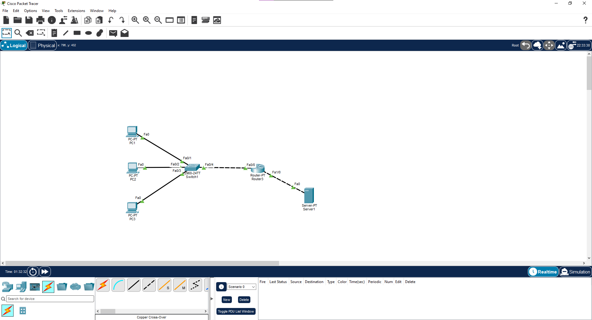
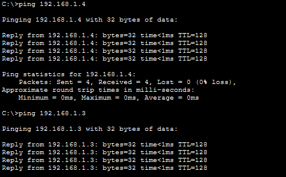
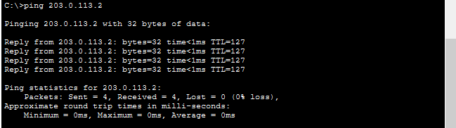
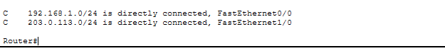
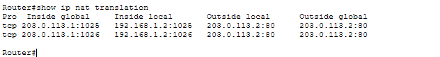
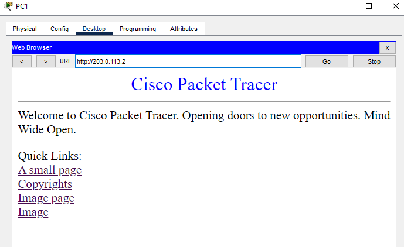

# Билет 5. Шлюз по умолчанию

Студент: Константинов Валерий  
Группа: РПО2/3

## Схема

Три компьютера подключены к коммутатору. Коммутатор соединён с портом FastEthernet0/0 маршрутизатора, сервер — с портом FastEthernet1/0. Кабели зелёные, связь есть.

## Адреса

Внутренняя сеть 192.168.1.0/24, маска 255.255.255.0. Она подключена к FastEthernet0/0. Внешняя сеть 203.0.113.0/24 подключена к FastEthernet1/0. Адрес этого порта, через который выходят компьютеры, — 203.0.113.1. Сервер имеет адрес 203.0.113.2. Компьютеры используют адреса 192.168.1.2, 192.168.1.3 и 192.168.1.4.

## Проверка внутри подсети

С компьютера выполнен ping адресов 192.168.1.4 и 192.168.1.3. Оба ответа пришли, потерь нет. TTL равен 128, пакет до соседа дошёл напрямую и через маршрутизатор не проходил.

## Проверка шлюза

Ping сервера 203.0.113.2 тоже проходит, четыре ответа и ноль потерь. TTL равен 127: ответ сервера уменьшился на единицу, значит пакет пересёк один маршрутизатор. Без шлюза этот адрес был бы недоступен, потому что он находится в другой сети.

## Таблица маршрутов

Обе сети подключены напрямую. 192.168.1.0/24 выходит через FastEthernet0/0, 203.0.113.0/24 — через FastEthernet1/0. Отдельный статический маршрут между ними не нужен.

## NAT

При открытии сайта маршрутизатор подменил адрес компьютера 192.168.1.2 на свой внешний адрес 203.0.113.1. Порт назначения 80 сохранился. Это PAT: несколько частных адресов могут выходить через один внешний, различаясь номером порта.

## HTTP

В браузере PC1 открыт адрес http://203.0.113.2. Страница сервера загрузилась. Запрос шёл по TCP, порт 80. Ping при этом использует ICMP и порта не имеет, поэтому успешный ping сам по себе ещё не доказывает, что сайт откроется. В этой работе открылись оба варианта.

## Вывод

Шлюз нужен для чужой сети. Соседние компьютеры 192.168.1.3 и 192.168.1.4 отвечают напрямую, а сервер 203.0.113.2 доступен только через маршрутизатор. PAT заменяет частный адрес 192.168.1.2 на 203.0.113.1, иначе сервер не знает обратный путь. Ping проверяет ICMP, а сайт проверяет TCP 80. Это разные протоколы: один может проходить, когда второй закрыт.
